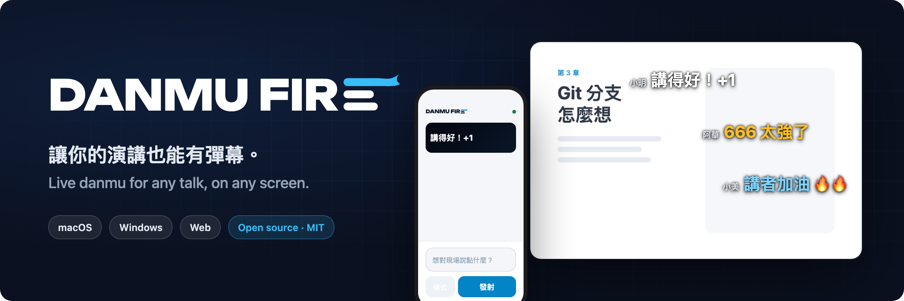
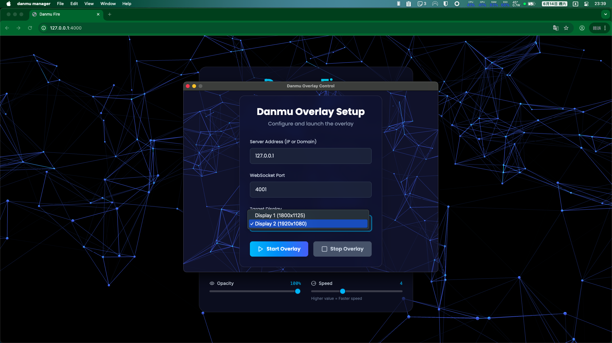
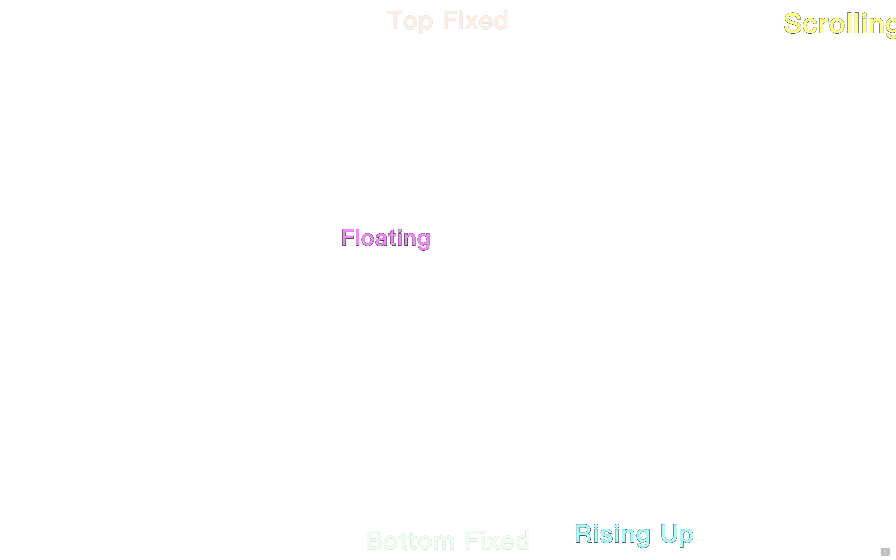
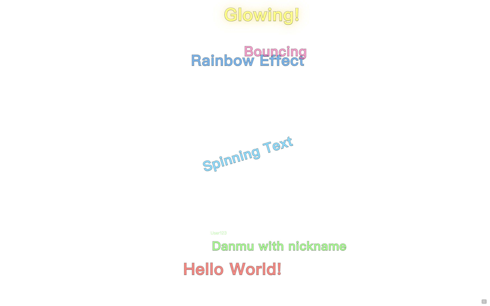

<p align="center"></p>

# danmu-desktop

在桌面直接顯示彈幕

[English README](https://github.com/guan4tou2/danmu-desktop/blob/main/README.md)

完整功能清單（伺服器路由、管理頁面、持久化對照、範圍規範）詳見 [docs/FEATURES.md](docs/FEATURES.md)。完整文件索引見 [docs/README.md](docs/README.md)。


## 概述

此專案分為兩個部分：

1. Danmu-Desktop
   - 客戶端應用程式，在您的電腦上運行以顯示彈幕
   - 支援 Windows、MacOS 和 Linux
   - 發布為可攜式桌面套件：Windows portable x64 `.exe`、macOS arm64
     `.zip`，以及 Linux AppImage / `.deb`
   - Windows 維持 portable-only 時不發布更新 metadata；macOS 更新 metadata
     指向 ZIP package




2. Server
   - 提供網頁介面用於彈幕輸入
   - 管理彈幕傳送到已連接的客戶端
   - 包含管理員配置面板、來源指紋記錄與歷史追蹤
   - OBS Browser Source 覆蓋層（`/overlay` 路由）
   - 插件 SDK 支援伺服器端擴展
   - 四語介面（EN、ZH、JA、KO）


## 功能特色

### 佈局模式

支援五種彈幕顯示佈局：捲動（右至左）、頂部固定、底部固定、浮動（隨機位置）、上升（由下至上）。



### 特效與樣式

內建動畫特效（旋轉、彈跳、彩虹、發光、抖動、波浪、閃爍、縮放），每個特效可調參數。支援暱稱、自訂顏色、文字描邊/陰影，以及多特效疊加。




### 熱插拔特效 (.dme)

將 `.dme` 檔案（YAML 格式）放入 `server/effects/` 目錄即可新增自訂特效，5 秒內自動偵測載入。可在管理面板中編輯和管理特效。

### 樣式主題

預定義視覺主題（預設、霓虹、復古、電影），一鍵切換顏色、描邊、陰影和特效組合。可在管理面板或使用者頁面切換主題。

### 互動投票

管理員建立 2-6 個選項的投票。觀眾透過發送選項代號（A/B/C）作為彈幕來投票。即時結果顯示在覆蓋層上，包含即時票數統計。

### 覆蓋層小工具

在 OBS 覆蓋層上新增持久的計分板、跑馬燈和標籤。從管理面板管理位置、樣式和內容。小工具透過 WebSocket 廣播至所有已連接的覆蓋層客戶端。

### OBS Browser Source

使用 `https://your-server/overlay` 作為 OBS Browser Source，無需 Electron 即可顯示彈幕。透明背景，透過 WebSocket 自動連接。

### 插件 SDK

建立伺服器端插件，可對彈幕事件做出反應、修改訊息、過濾內容和自動回覆。每 5 秒熱載入。詳見[插件開發指南](server/PLUGIN_GUIDE.md)。

### 時間軸匯出

將即時彈幕場次錄製為 JSON 時間軸，供離線回放或分析使用。可從管理面板操作。

## 安裝與使用

### Danmu-Desktop 客戶端

1. 下載[最新版本](https://github.com/guan4tou2/danmu-desktop/releases)
2. macOS 使用者解除隔離：
   ```bash
   sudo xattr -r -d com.apple.quarantine 'Danmu Desktop.app'
   ```
3. 啟動應用程式
4. 輸入伺服器 host 與設定精靈顯示的 HTTPS/web port

Mac 更新：下載新版 arm64 ZIP，結束程式，再以解壓縮的新版取代舊程式。
原有設定會保留。此版本採用臨時簽章，更新按鈕會提供下載入口，需手動替換。

待送彈幕從第一次排隊起保留 24 小時，到期後自動失效；重啟伺服器或再次暫停不會延長期限。
伺服器會在啟動時及每 60 秒清理待送佇列；磁碟正常時，即使閒置也會在下一個週期移除到期資料，等候清理期間不會再送出。清理範圍只有待送佇列，歷史紀錄與封存備份另行保留。

歷史紀錄會區分等待顯示、已送往顯示端與顯示端已回報呈現。「顯示端已回報呈現」代表至少一個桌面或瀏覽器顯示端回報可見的動畫畫面，不代表觀眾一定看見或 OBS 已擷取。
30 秒內沒有有效回報會標示「未確認」並提供原因；舊版顯示端仍可播放，但不會回報。未確認的訊息不會自動重播。

### 伺服器設置

正規安裝路徑是 `./setup.sh init` — 一個互動式精靈，會根據你的
環境挑合理預設、自動產生 secret、寫好 `.env`。第一層會用部署情境呈現：
IP/localhost + HTTP dev、IP + HTTPS 自簽、Domain + HTTPS 自簽、以及
Domain + HTTPS Let's Encrypt。兩個自簽 HTTPS 情境共用同一個 compose
profile，只是憑證 SAN 的提示不同。

```bash
git clone https://github.com/guan4tou2/danmu-desktop.git
cd danmu-desktop
./setup.sh init                      # 互動式：模式、密碼、ports、desktop client
./setup.sh init --advanced           # + 速率限制、log、資源上限
./setup.sh check                     # 啟動前驗證現有 .env
./setup.sh gen-secret                # 只產生並寫入 SECRET_KEY

# 再啟動 stack。精靈會印出確切指令，常見路徑：
docker compose --profile https up -d         # IP/Domain + HTTPS 自簽 — 推薦
docker compose --profile traefik up -d       # Domain + HTTPS Let's Encrypt
docker compose --profile http up -d          # IP/localhost + HTTP dev only
```

> v5.0.0+：Electron 桌面客戶端固定走 `wss://`。正式對外入口是
> `443` 上的 HTTPS/WSS，同一個 web origin 的 `/ws` 提供 WebSocket。
> `--profile http` 可跑後端 + web admin/viewer，但 desktop overlay 無法連線。

完整部署文件（HTTPS 模式、桌面客戶端連線、Redis、備份/還原、升級）：
**[DEPLOYMENT.md](DEPLOYMENT.md)**。

#### 捷徑：預編譯映像，無需 clone

若你只要跑 server，不需要原始碼：

可使用預建 `ghcr.io/guan4tou2/danmu-server:latest` image，但需放在 HTTPS
反向代理後方。不要直接 publish app container；對外只開 `443` TLS 入口。

`SECRET_KEY` 在 production 為必填 — 啟動時會拒絕 ephemeral key。
`openssl rand -hex 32` 會即時產一把；記下來才能在 container 重建後保有
相同的 session。

多架構（`linux/amd64` + `linux/arm64/v8`）。Tags：`latest`、`main`、
`<git-sha>`。若要給 desktop 使用，前面必須接 `443` HTTPS，並把 `/ws`
轉到同一個私有 upstream。

#### 手動（不使用 Docker）

```bash
cp .env.example .env
./setup.sh gen-secret                # 寫入 SECRET_KEY
# 編輯 .env：設定 ADMIN_PASSWORD

cd server && uv venv && uv sync
PYTHONPATH=.. uv run python -m server.app    # HTTP + /ws 都從這邊起
```

### 存取伺服器

啟動後開啟精靈印出的 HTTPS endpoint：

- 主介面：`https://<host>`
- 管理面板：`https://<host>/admin`
- OBS overlay：`https://<host>/overlay`

Desktop 與 viewer 都應只使用這個 HTTPS origin。

### 環境變數

`.env.example` 有完整註解。精靈會幫你處理的關鍵變數：

| 變數 | 用途 |
|---|---|
| `ADMIN_PASSWORD` / `ADMIN_PASSWORD_HASHED` | 管理員登入（至少設一個） |
| `SECRET_KEY` | Flask session 密鑰（精靈 / `gen-secret` 產生） |
| `ENV` | `production` 啟用嚴格 session / HSTS 預設值 |
| `HTTPS_PORT` | 自簽 HTTPS profile 的覆寫值；預設 `443`，desktop 仍走同一個 port 的 `/ws` |
| `TRUSTED_HOSTS` | Host header 白名單（逗號分隔） |
| `SESSION_COOKIE_SECURE` | production 走 HTTPS 時設 `true` |
| `WS_REQUIRE_TOKEN` / `WS_AUTH_TOKEN` | `/ws` 共用 token 驗證的首次啟動種子值；之後由後台「安全」管理 |
| `RATE_LIMIT_BACKEND` | `memory` 或 `redis`（透過 `--profile redis` 啟） |

其他設定都有安全預設；`.env.example` 列齊了所有項目。

## 安全備註

- 此 repo 已啟用 GitHub Advanced Security 與 Dependabot。
- OSV 掃描會在 `push`、`pull_request` 與排程任務執行（見 `.github/workflows/osv-scanner.yml`）。
- 前端 lockfile 透過 npm overrides 強制 `serialize-javascript@7.0.3`，對應 `GHSA-5c6j-r48x-rmvq`。
- 新安裝且未設定兩個 WS 驗證環境變數時，預設啟用驗證並產生隨機密碼；明確設定的 `WS_REQUIRE_TOKEN=false` 會保留。`server/runtime/ws_auth.json` 建立後，以檔案內儲存狀態為準；更新、重啟及更改環境變數不會自動改變既有部署的設定。
- 驗證關閉且 web port 對 localhost 或受信任 LAN 以外可達時，任何能連到 `/ws` 的人都可連接顯示層並接收彈幕；這不會開放後台管理權限。安全啟用順序：到「後台 → 安全 → 顯示層連線密碼」，保持驗證關閉，必要時先產生密碼；將密碼貼到每台桌面程式的「WS Token」設定並儲存，再回後台開啟驗證並儲存。於合適時機讓各桌面端重連，確認測試彈幕可顯示。儲存後只影響新連線與重連，現有連線會保留。密碼不要放進公開網址或截圖；詳見[部署指南](./DEPLOYMENT.md)的 Desktop Client 章節。
- production 啟動現在會拒絕以下不安全設定：未明確設定 `SECRET_KEY`、`SESSION_COOKIE_SECURE=false`、或未設定 `TRUSTED_HOSTS`。部署前請先補齊。
- 目前 app 會送出 nonce-based `Content-Security-Policy` header。之後若新增 inline script，請使用模板提供的 nonce，不要退回 `unsafe-inline`。
- `Strict-Transport-Security` 目前是 opt-in，需明確設定 `HSTS_ENABLED=true`，且只會在 HTTPS 回應上送出。

## 專案文件

- [`DESIGN.md`](./DESIGN.md) – 設計系統（brand、color、typography、motion、a11y、voice）。所有視覺決策的單一真相來源。
- `docs/perf/baseline-v4.6.1.md` – performance baseline（HTTP payload、latency、font loading）。
- `docs/designs/` – 設計探索產出（排版比較頁等）。
- `docs/audits/` – 設計審查 audit 報告（依 round 編列）。
- `docs/README.md` – 技術文件與 archive 的索引。
- `DEPLOYMENT.md` – production 部署指南。
- `server/PLUGIN_GUIDE.md` – Plugin SDK 開發文件。
- `README.md` – 英文總覽。
- `docs/archive/` – 歷史紀錄與整理檔案。

## CI/CD 與 Docker Hub

- `.github/workflows/docker-build.yml` 會在每次 PR / push 時建置與測試伺服器映像。
- `.github/workflows/test.yml` 執行 Python 測試（含覆蓋率報告、`pip-audit` CVE 掃描，以及 CSS 設計 token 防回歸 lint `scripts/check-css-tokens.mjs`——新增裸 hex 色碼會使此步驟失敗）。
- `.github/workflows/build.yml` 在版本更新時為 Windows、macOS、Linux 建置 Electron 應用程式，並建立含自動更新中繼資料的 GitHub Releases。
- 於 GitHub Secrets 設定 `DOCKERHUB_USERNAME` 與 `DOCKERHUB_TOKEN`（Docker Hub Access Token），即可在 main 更新時自動推送 `DOCKERHUB_USERNAME/danmu-server:latest` 與對應 commit SHA tag。

## 測試與覆蓋率

- 執行測試：`make test` 或 `make test-verbose`
- 產生覆蓋率報告：`make coverage`
  - 終端會顯示 `coverage report`
  - HTML 報告位於 `server/htmlcov/index.html`

## 端口配置

- 正式對外入口：`443` 上的 `https://<host>` 與 `wss://<host>/ws`
- Desktop、viewer、admin、OBS overlay、WebSocket 都共用這個 HTTPS/WSS 入口
- 若自簽 HTTPS profile 必須使用自訂 port，只設定單一 `HTTPS_PORT`；不要再開第二個 WS port

## 參考資料

SAO UI 設計參考自 [SAO-UI-PLAN-LINK-START | Akilar の糖果屋](https://akilar.top/posts/1b4fa1dd/)
