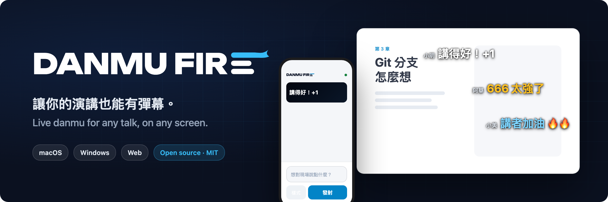
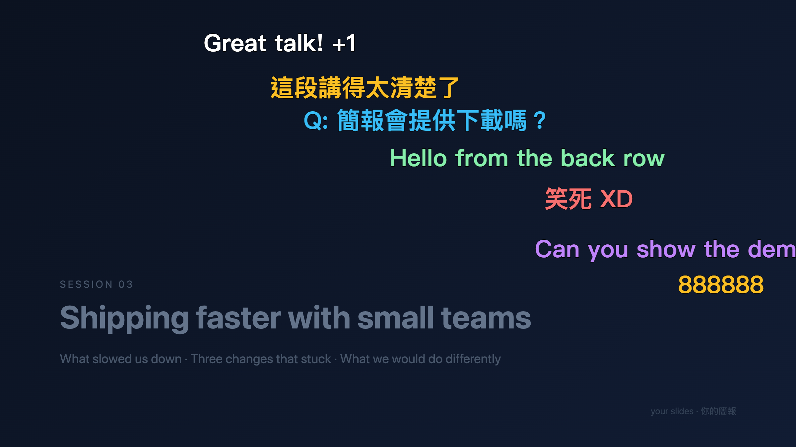
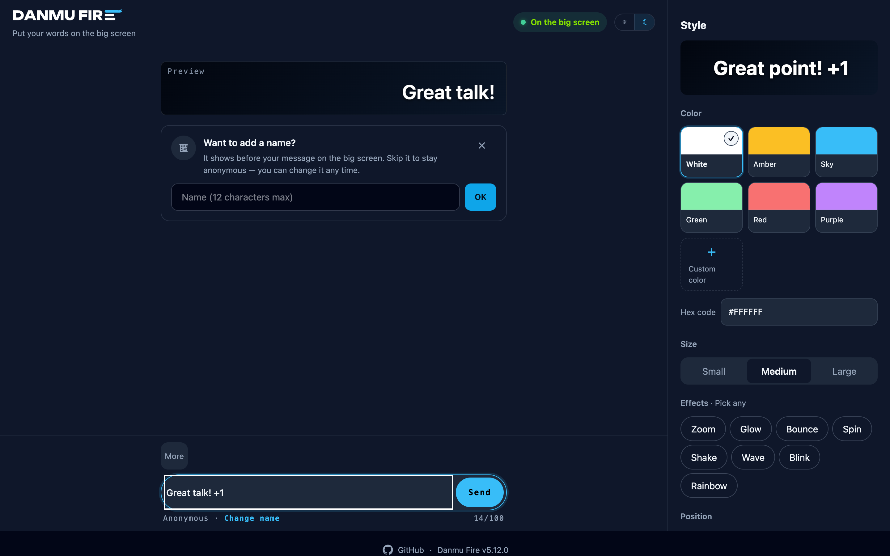
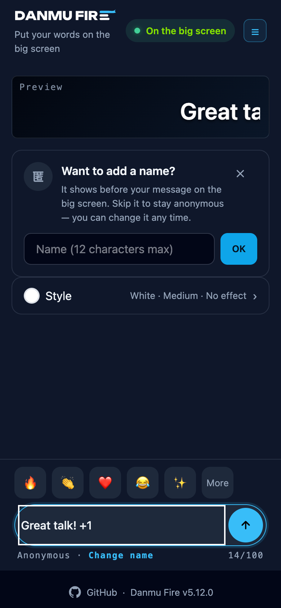
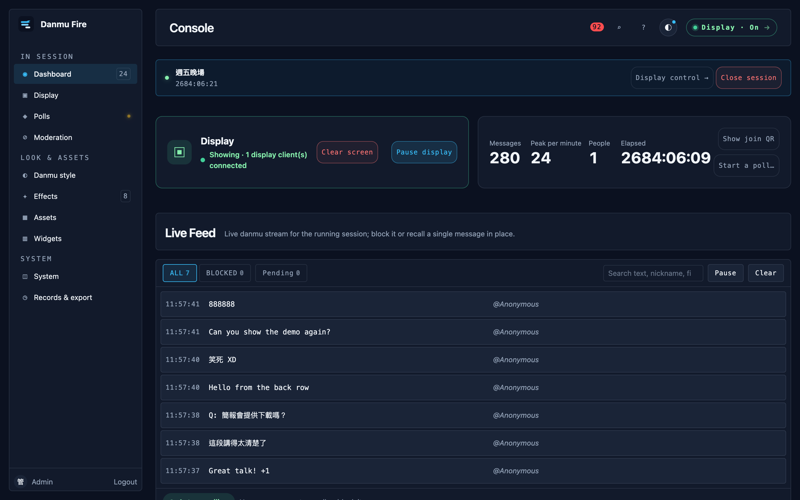
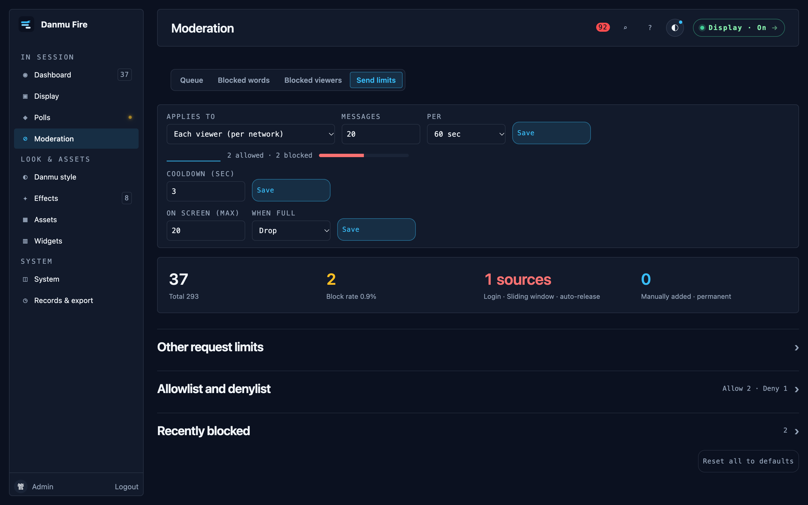
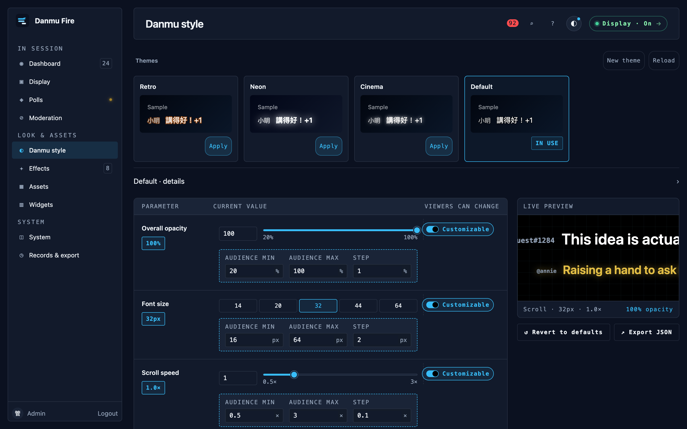
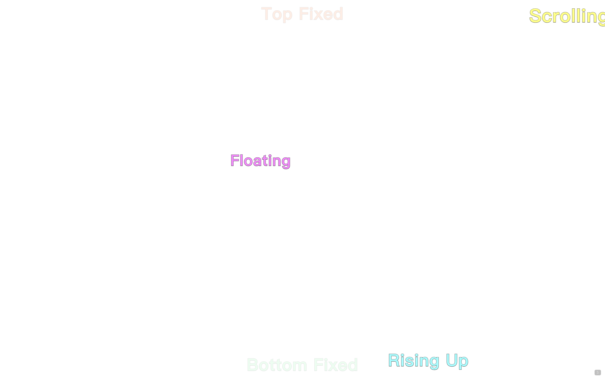
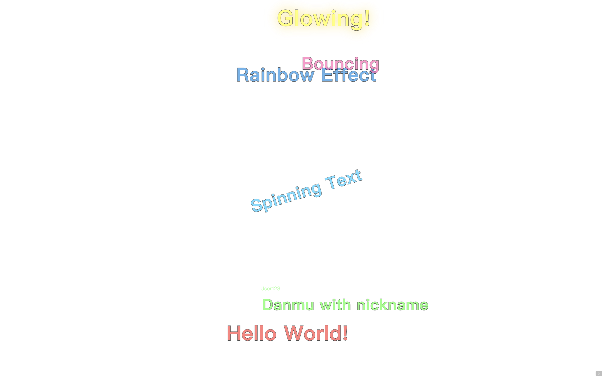

<p align="center"></p>

# danmu-desktop

讓任何一場演講都能有彈幕：觀眾用手機送出訊息，訊息飄過講者的螢幕。

[English README](README.md)



<sub>彈幕由顯示端實際繪製；後方的簡報是為了這張截圖加上的示意底圖——顯示端本身是透明的。</sub>

## 運作方式

| 組成 | 做什麼 |
|---|---|
| **伺服器**（`server/`） | 同一個網址提供觀眾頁、後台、`/overlay` 瀏覽器來源，以及推送彈幕給所有顯示端的 `/ws` WebSocket。 |
| **桌面客戶端**（`danmu-desktop/`） | Electron 應用程式，支援 Windows、macOS、Linux。在你選的螢幕上開一個透明、滑鼠可穿透的視窗，把彈幕畫在目前的畫面上。 |
| **Slido 橋接**（`slido-extension/`） | 選用的 Chrome 擴充功能，把 Slido 活動的新提問變成彈幕。 |

不裝桌面客戶端也可以：把 `https://<host>/overlay` 加進 OBS 的瀏覽器來源。

## 畫面

**觀眾頁**——觀眾打開的頁面，手機直接用，不必安裝任何東西。

<p>
  
  
</p>

**後台**——即時訊息與顯示控制、審核、彈幕樣式。





<sub>截圖為英文介面；介面語言跟隨瀏覽器，後台與觀眾頁都有繁體中文。</sub>

**排版與效果**





## 功能

**觀眾**

- 任何瀏覽器都能送出；可選暱稱、顏色、大小與效果——哪些可以改由主持人決定。
- 五種排版：滾動、頂部、底部、浮動、上升。
- 八種內建效果（縮放、發光、彈跳、旋轉、震動、波浪、閃爍、彩虹），可以疊加。
- 送出選項代號（A／B／C…）就能投票。觀眾永遠看不到票數。
- 四種介面語言：English、繁體中文、日本語、한국어。

**主持人**

- **控制台**——即時訊息流、暫停或清空顯示層、就地封鎖發送者或收回單則訊息。
- **投票**——可連續多題，每題 2–6 個選項，可附圖片與作答時限。
- **審核**——封鎖規則（關鍵字、正規式、頻率、裝置），命中時拒絕、替換或保留待審；審核佇列；可設期限的封鎖（依裝置或 IP）；發送上限：每則之間的冷卻、同時在畫面上的彈幕數、請求速率上限。
- **彈幕樣式**——主題（預設、霓虹、復古、電影，或自訂）決定字型、顏色、描邊與陰影；以及觀眾的預設值與可調範圍。
- **動畫效果**——可熱插拔的 `.dme` 檔（YAML）。放進 `server/effects/` 或在後台直接編輯。
- **素材**——表情、貼圖、字型（可做子集化，把大型中日韓字型縮小）與音效。
- **小工具**——固定在顯示層上的計分板、跑馬燈與標籤。
- **紀錄與匯出**——場次、觀眾、搜尋、操作紀錄；每則訊息的送達狀態。
- **系統**——安全設定、備份與還原，以及擴充：Slido 橋接、給整合用的 Fire Token、Webhook、伺服器插件（[插件指南](server/PLUGIN_GUIDE.md)）、API Token、定時發送。

完整功能清單見 [docs/FEATURES.md](docs/FEATURES.md)。

## 快速開始

### 伺服器

`./setup.sh init` 是互動式精靈：依你的環境挑預設值、產生密鑰並寫入 `.env`。
它提供四種情境：IP／localhost + HTTP（開發）、IP + HTTPS 自簽、Domain + HTTPS 自簽、
Domain + HTTPS Let's Encrypt。

```bash
git clone https://github.com/guan4tou2/danmu-desktop.git
cd danmu-desktop
./setup.sh init                      # 互動：模式、密碼、連接埠、桌面客戶端
./setup.sh init --advanced           # 另含速率限制、日誌、資源上限
./setup.sh check                     # 啟動前驗證既有的 .env
./setup.sh gen-secret                # 只產生並寫入 SECRET_KEY

# 接著啟動。精靈會印出確切指令；常見的有：
docker compose --profile https up -d         # IP／Domain + HTTPS 自簽——建議
docker compose --profile traefik up -d       # Domain + HTTPS Let's Encrypt
docker compose --profile http up -d          # IP／localhost + HTTP，僅供開發
```

啟動後，打開精靈印出的 HTTPS 網址：

- 觀眾頁：`https://<host>`
- 後台：`https://<host>/admin`
- OBS overlay：`https://<host>/overlay`

觀眾頁、後台、OBS overlay、桌面客戶端與 WebSocket（`wss://<host>/ws`）全部
共用這一個 HTTPS 入口（連接埠 `443`）。自簽模式若必須用別的連接埠，設定
`HTTPS_PORT` 即可；沒有第二個 WebSocket 連接埠。

> 桌面客戶端只走 `wss://`。`--profile http` 能跑伺服器、觀眾頁與後台，但
> 無法提供桌面 overlay。

完整部署說明（HTTPS 模式、桌面客戶端連線、Redis、備份還原、升級）：
**[DEPLOYMENT.md](DEPLOYMENT.md)**。

<details>
<summary>直接用預建映像檔，不 clone</summary>

把 `ghcr.io/guan4tou2/danmu-server:latest` 放在 HTTPS 反向代理後面。不要直接
對外公開應用程式容器；只開放 `443` 的 TLS 入口，並把 `/ws` 轉到同一個內部
上游。

正式環境必須設定 `SECRET_KEY`——啟動時會拒絕臨時產生的金鑰。可用
`openssl rand -hex 32` 產生；請保存下來，重建容器後 session 才會延續。

多架構（`linux/amd64` + `linux/arm64/v8`）。標籤：`latest`、`main`、
`<git-sha>`。

</details>

<details>
<summary>手動安裝，不用 Docker</summary>

```bash
cp .env.example .env
./setup.sh gen-secret                # 寫入 SECRET_KEY
# 編輯 .env：設定 ADMIN_PASSWORD

cd server && uv venv && uv sync
PYTHONPATH=.. uv run python -m server.app    # HTTP 與 /ws 都由這裡提供
```

</details>

### 桌面客戶端

1. 下載[最新版本](https://github.com/guan4tou2/danmu-desktop/releases)。
   發布為可攜式桌面套件：Windows portable x64 `.exe`、macOS arm64 `.zip`、
   Linux AppImage 或 `.deb`。
2. 僅 macOS——解除隔離：
   ```bash
   sudo xattr -r -d com.apple.quarantine 'Danmu Desktop.app'
   ```
3. 啟動應用程式，輸入設定精靈印出的伺服器主機與 HTTPS 連接埠。

Mac 更新：下載新的 arm64 ZIP、結束應用程式，用解壓後的版本取代舊的。設定
保留在使用者設定檔裡。這些是 ad-hoc 簽署的套件，提供的是下載而不是自動
安裝。Windows 維持 portable-only 時不發布更新 metadata；macOS 的更新 metadata
指向 ZIP 套件。

### Slido 橋接

在**後台 → 系統 → 擴充**的 Slido 卡片下載擴充功能（.zip）並產生 Fire token。
解壓縮後到 `chrome://extensions` 以「載入未封裝項目」載入，再把本站網址與
token 填進擴充功能的 popup。細節與限制見
[slido-extension/README.md](slido-extension/README.md)。

## 送達與待處理訊息

待處理訊息在第一次進入待命佇列的 24 小時後過期。伺服器只在啟動時與每 60 秒
掃一次待處理佇列，因此在磁碟 I/O 正常的情況下，即使閒置，過期項目也會在下
一次掃描時移除。過期訊息在等待清理期間不會被轉送；歷史紀錄與封存備份另外
保留。重啟伺服器或再次暫停都不會延長期限。

送達紀錄區分「已排入」「已轉送」「已顯示」。「已顯示」表示至少一個桌面或
瀏覽器 overlay 回報畫出了可見的動畫影格；它不代表有人看到，也不代表 OBS 有
擷取到。30 秒內沒有收到有效回報，結果就是「未確認」，原因會顯示在歷史紀錄
中。舊版客戶端仍能顯示訊息，只是不回報。未確認的訊息不會自動重播。

## 設定

`.env.example` 有完整且附說明的清單。精靈會幫你設定的有：

| 變數 | 用途 |
|---|---|
| `ADMIN_PASSWORD`／`ADMIN_PASSWORD_HASHED` | 後台登入（至少設定一個） |
| `SECRET_KEY` | Flask session 金鑰（精靈或 `gen-secret` 產生） |
| `ENV` | `production` 啟用嚴格的 session／HSTS 預設 |
| `HTTPS_PORT` | 自簽 HTTPS 模式的連接埠；預設 `443`，桌面客戶端用同一個連接埠加 `/ws` |
| `TRUSTED_HOSTS` | Host 標頭的允許清單，逗號分隔 |
| `SESSION_COOKIE_SECURE` | 正式環境走 HTTPS 時為 `true` |
| `WS_REQUIRE_TOKEN`／`WS_AUTH_TOKEN` | `/ws` 共用 token 驗證的首次啟動種子；之後改在後台 → 系統 → 安全調整 |
| `RATE_LIMIT_BACKEND` | `memory` 或 `redis`（以 `--profile redis` 啟用） |

其餘設定都有安全的預設值。日常設定在後台調整並存到 `server/runtime/`。
同一個設定兩邊都有時（例如請求速率上限），以後台存的值為準，蓋過環境變數。

## 專案結構

```
server/            Flask 後端、觀眾頁、後台、/overlay、/ws
danmu-desktop/     Electron 桌面客戶端（控制視窗＋overlay 視窗）
slido-extension/   Chrome 擴充功能：Slido 提問 → 彈幕
shared/            兩邊共用的設計 token 與彈幕繪製程式
scripts/           repo 工具（CSS token 檢查、版本號、備份、部署）
nginx/ traefik/    各 compose profile 用的反向代理設定
docs/              文件（索引：docs/README.md）
img/               README 截圖
```

各部分怎麼接在一起、一則訊息怎麼走、狀態存在哪裡：
**[docs/ARCHITECTURE.md](docs/ARCHITECTURE.md)**。

## 開發

Node.js 24（最低 22.12）與已提交的 lockfile；Python 用 `uv`。

```bash
make help                                    # 列出所有 target
make run                                     # 在本機跑伺服器
make test                                    # 伺服器測試（pytest）
make lint-css                                # CSS token 檢查（CI 也會跑）
cd server && npm ci && npm run test:js -- --runInBand        # 後台／觀眾頁腳本測試
cd danmu-desktop && npm ci && npm test -- --runInBand        # 桌面客戶端測試
```

生成檔要一起提交，CI 會檢查。改了後台腳本要跑
`cd server && npm run build:admin-js`；改了語系檔要在你改的那個目錄跑
`npm run build:i18n`（`server/` 與 `danmu-desktop/` 各有一支）。詳見
[docs/ARCHITECTURE.md](docs/ARCHITECTURE.md#generated-files-commit-them-with-the-source-change)
與 [CONTRIBUTING.md](CONTRIBUTING.md)。

覆蓋率：`make coverage`（HTML 報告在 `server/htmlcov/index.html`）。

### CI 與發行

- `.github/workflows/test.yml`——Python 測試與覆蓋率、`pip-audit`、JS 測試、生成檔檢查，以及 CSS token 檢查（`scripts/check-css-tokens.mjs`，新增寫死的色碼會失敗）。
- `.github/workflows/docker-build.yml`——每個 PR／push 建置並測試伺服器映像檔。設定 `DOCKERHUB_USERNAME` 與 `DOCKERHUB_TOKEN` 後，push 到 `main` 會另外發布 `DOCKERHUB_USERNAME/danmu-server:latest` 與 commit SHA 標籤。
- `.github/workflows/build.yml`——版本號變動時為 Windows、macOS、Linux 建置 Electron 應用程式並發布 GitHub Release。會發布 macOS ZIP 的更新 metadata；Windows 維持可攜式，不發布。
- `.github/workflows/osv-scanner.yml`——push、pull request 與排程時做 OSV 掃描。

## 安全注意事項

- 此 repo 已啟用 GitHub Advanced Security 與 Dependabot。
- 前端 lockfile 透過 npm overrides 固定 `serialize-javascript@7.0.3`，以處理 `GHSA-5c6j-r48x-rmvq`。
- 全新安裝且兩個 WS 驗證環境變數都沒設定時，會以「啟用 token 驗證＋自動產生 token」啟動。明確設定 `WS_REQUIRE_TOKEN=false` 會被尊重。`server/runtime/ws_auth.json` 存在之後，以它保存的狀態為準；升級、重啟或更改環境變數都不會自動改變既有部署的設定。
- 若 WS 驗證關閉，而網頁連接埠能從 localhost 或受信任區網以外連到，任何連得到 `/ws` 的人都能接上一個顯示端並收到彈幕；這不會給予後台權限。安全的啟用方式：打開**後台 → 系統 → 安全**（顯示層連線密碼），在驗證仍關閉時視需要產生 token，把它貼進每一台桌面應用程式的 **WS Token** 設定並儲存，再回後台啟用驗證並儲存。找適當的時機讓各桌面重新連線，並送一則測試彈幕確認。儲存的變更只對新連線／重新連線的客戶端生效，既有連線不會中斷。不要把 token 放進公開網址或截圖。細節見 [DEPLOYMENT.md](./DEPLOYMENT.md) 的 **Desktop Client** 一節。
- 正式環境啟動時會拒絕臨時的 `SECRET_KEY`、`SESSION_COOKIE_SECURE=false` 或未設定的 `TRUSTED_HOSTS`。部署前請明確設定。
- 應用程式送出以 nonce 為基礎的 `Content-Security-Policy` 標頭。新增 inline script 時請用模板的 nonce，不要退回 `unsafe-inline`。
- `Strict-Transport-Security` 需以 `HSTS_ENABLED=true` 明確開啟，而且只在 HTTPS 回應送出。

## 文件

| 文件 | 內容 |
|---|---|
| [docs/ARCHITECTURE.md](docs/ARCHITECTURE.md) | 專案結構、訊息流程、狀態存放位置 |
| [docs/FEATURES.md](docs/FEATURES.md) | 功能清單、後台路由對照、持久化對照 |
| [DEPLOYMENT.md](DEPLOYMENT.md) | Docker、HTTPS 模式、VPS 部署、升級 |
| [server/PLUGIN_GUIDE.md](server/PLUGIN_GUIDE.md) | 撰寫伺服器插件 |
| [slido-extension/README.md](slido-extension/README.md) | Slido 橋接 |
| [DESIGN.md](DESIGN.md) | 設計系統：品牌、色彩、字體、動態、無障礙 |
| [CONTRIBUTING.md](CONTRIBUTING.md) | 環境設定、慣例、生成檔 |
| [CHANGELOG.md](CHANGELOG.md)・[TODOS.md](TODOS.md) | 發行紀錄・待辦 |
| [docs/README.md](docs/README.md) | `docs/` 底下其餘文件的索引 |

## 參考

SAO UI 設計靈感來自 [SAO-UI-PLAN-LINK-START | Akilar の糖果屋](https://akilar.top/posts/1b4fa1dd/)
