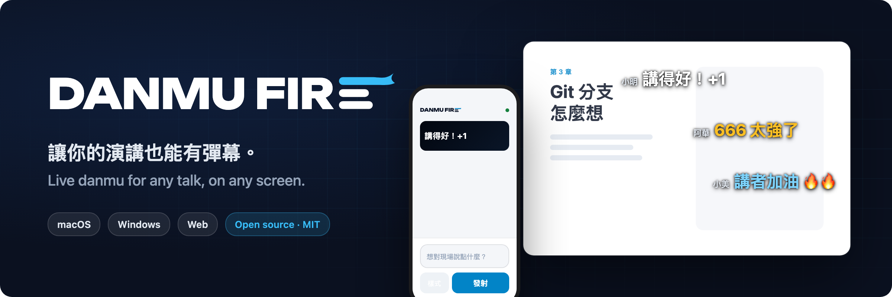
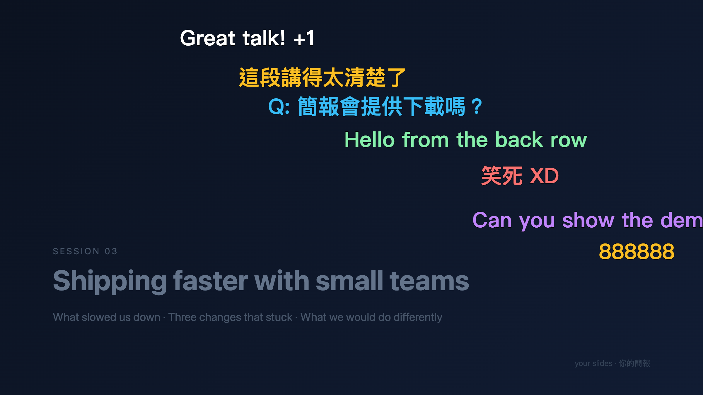
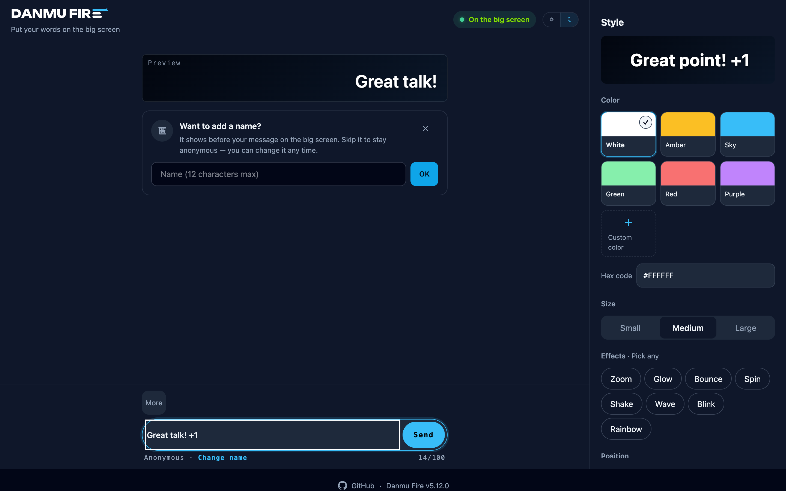
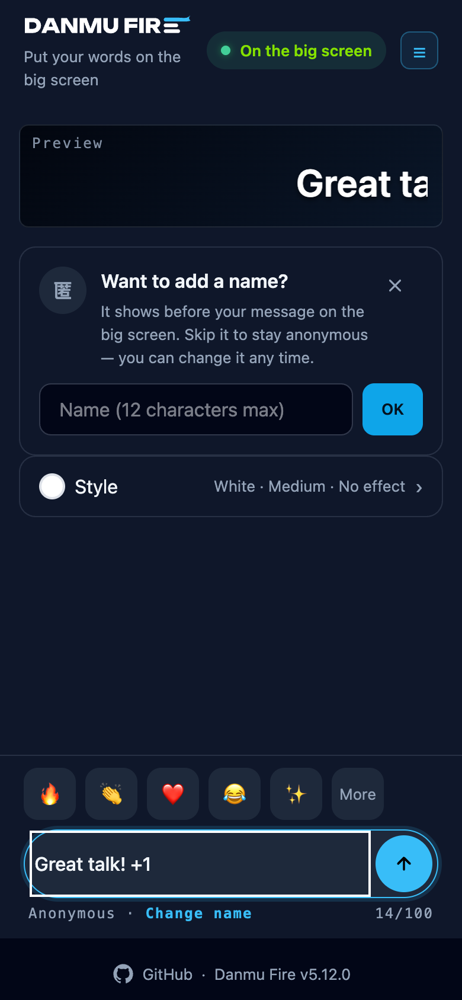
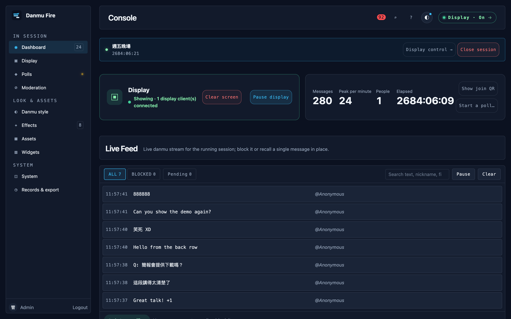
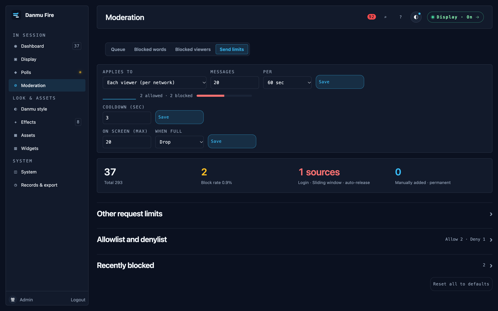
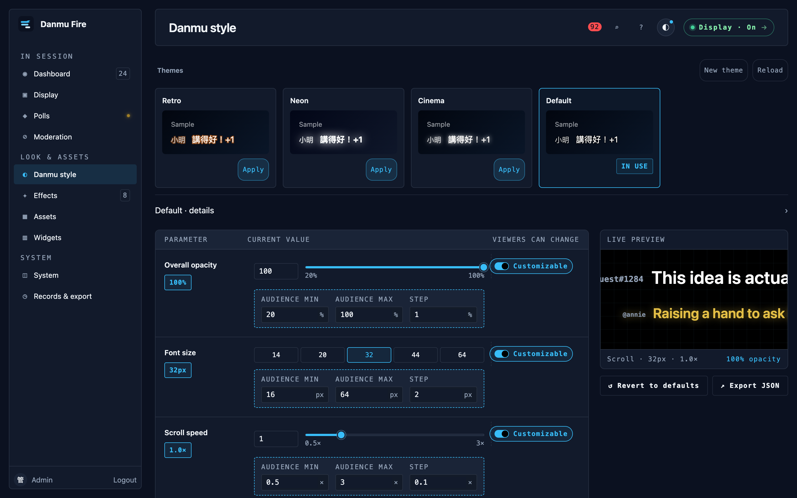
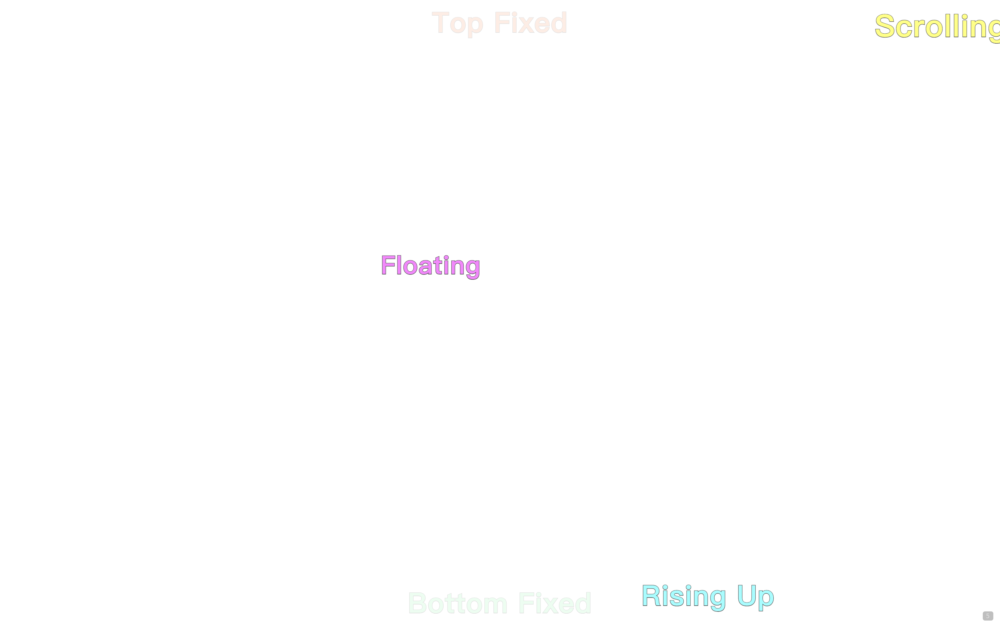
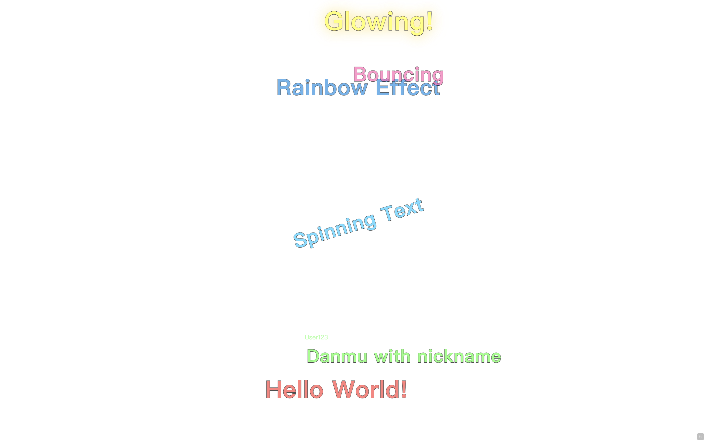

<p align="center"></p>

# danmu-desktop

Live danmu (bullet comments) for any talk. The audience sends messages from
their phones; the messages fly across the presenter's screen.

在桌面直接顯示彈幕 · [中文說明](README-CH.md)



<sub>Danmu drawn by the display. The slide behind them is a mock backdrop added for this screenshot — the display itself is transparent.</sub>

## How it works

| Part | What it does |
|---|---|
| **Server** (`server/`) | One web origin that serves the viewer page, the admin panel, the `/overlay` browser source, and the `/ws` WebSocket that feeds every display. |
| **Desktop client** (`danmu-desktop/`) | Electron app for Windows, macOS and Linux. Opens a transparent, click-through window on the screen you pick and draws danmu over whatever is showing. |
| **Slido bridge** (`slido-extension/`) | Optional Chrome extension that turns new questions from a Slido event into danmu. |

No desktop app? Add `https://<host>/overlay` to OBS as a Browser Source instead.

## Screenshots

**Viewer page** — what the audience opens. Works on a phone without installing anything.

<p>
  
  
</p>

**Admin panel** — live feed and display control, moderation, danmu style.





**Layouts and effects**





## Features

**For the audience**

- Send from any browser; optional nickname, colour, size and effects — the host decides which of these viewers may change.
- Five layouts: scroll, top, bottom, float, rise.
- Eight built-in effects (zoom, glow, bounce, spin, shake, wave, blink, rainbow) that can be stacked.
- Vote in polls by sending the option key (A / B / C…). Viewers never see vote counts.
- Four interface languages: English, 繁體中文, 日本語, 한국어.

**For the host**

- **Dashboard** — live feed, pause or clear the display, block a sender or recall one message in place.
- **Polls** — several questions in a row, 2–6 options each, optional image and time limit per question.
- **Moderation** — block rules (keyword, regex, frequency, device) that reject, replace or hold for review; a review queue; time-bound bans by device or IP; and send limits: cooldown between messages, how many danmu may be on screen at once, and request rate limits.
- **Danmu style** — themes (default, neon, retro, cinema, or your own) that set font, colour, stroke and shadow; the defaults viewers start with and the ranges they may pick from.
- **Effects** — hot-pluggable `.dme` files (YAML). Drop one into `server/effects/` or edit it in the admin panel.
- **Assets** — emojis, stickers, fonts (with subsetting to shrink large CJK fonts) and sounds.
- **Widgets** — scoreboards, tickers and labels pinned on the display.
- **Records & export** — sessions, audience, search, audit log; delivery status per message.
- **System** — security settings, backup and restore, and extensions: Slido bridge, Fire Token for integrations, webhooks, server plugins ([Plugin Guide](server/PLUGIN_GUIDE.md)), API tokens, scheduled messages.

The full inventory is in [docs/FEATURES.md](docs/FEATURES.md).

## Quick start

### Server

`./setup.sh init` is an interactive wizard: it picks defaults for your
environment, generates secrets and writes `.env`. It offers four scenarios:
IP/localhost + HTTP (dev), IP + HTTPS self-signed, Domain + HTTPS
self-signed, and Domain + HTTPS Let's Encrypt.

```bash
git clone https://github.com/guan4tou2/danmu-desktop.git
cd danmu-desktop
./setup.sh init                      # interactive: mode, password, ports, desktop client
./setup.sh init --advanced           # + rate limits, logging, resource caps
./setup.sh check                     # validate an existing .env before startup
./setup.sh gen-secret                # generate + inject SECRET_KEY only

# Then start the stack. The wizard prints the exact command; common paths:
docker compose --profile https up -d         # IP/Domain + HTTPS self-signed — recommended
docker compose --profile traefik up -d       # Domain + HTTPS Let's Encrypt
docker compose --profile http up -d          # IP/localhost + HTTP dev only
```

After start-up, open the HTTPS endpoint printed by the wizard:

- Viewer page: `https://<host>`
- Admin panel: `https://<host>/admin`
- OBS overlay: `https://<host>/overlay`

With `--profile http` (development only) there is no TLS: the pages are at
`http://<host>:<HTTP_DEV_PORT>`, with the same paths. `HTTP_DEV_PORT` is read
from `.env`; its default is in `docker-compose.yml`.

Everything — viewer, admin, OBS overlay, desktop client and WebSocket
(`wss://<host>/ws`) — shares that single HTTPS origin on port `443`. If the
self-signed profile must use another port, set `HTTPS_PORT`; there is no
second WebSocket port.

> The desktop client connects over `wss://` only. `--profile http` runs the
> server, viewer and admin pages, but cannot serve the desktop overlay.

Full deploy guide (HTTPS modes, desktop-client connection, Redis, backup and
restore, upgrades): **[DEPLOYMENT.md](DEPLOYMENT.md)**.

<details>
<summary>Prebuilt image, no clone</summary>

Use `ghcr.io/guan4tou2/danmu-server:latest` behind an HTTPS reverse proxy.
Do not publish the app container directly; expose only the TLS endpoint on
port `443` and forward `/ws` to the same private upstream.

`SECRET_KEY` is required in production — startup refuses an ephemeral key.
`openssl rand -hex 32` generates one; save it so sessions survive container
recreates.

Multi-arch (`linux/amd64` + `linux/arm64/v8`). Tags: `latest`, `main`,
`<git-sha>`.

</details>

<details>
<summary>Manual, no Docker</summary>

```bash
cp .env.example .env
./setup.sh gen-secret                # writes SECRET_KEY
# Edit .env: set ADMIN_PASSWORD

cd server && uv venv && uv sync
PYTHONPATH=.. uv run python -m server.app    # HTTP + /ws both run from here
```

</details>

### Desktop client

1. Download the [latest release](https://github.com/guan4tou2/danmu-desktop/releases).
   It is published as a portable desktop package: Windows portable x64 `.exe`,
   macOS arm64 `.zip`, Linux AppImage or `.deb`.
2. macOS only — lift the quarantine:
   ```bash
   sudo xattr -r -d com.apple.quarantine 'Danmu Desktop.app'
   ```
3. Launch the app and enter the server host and HTTPS port printed by the setup wizard.

Mac updates: download the new arm64 ZIP, quit the app, and replace the
previous app with the extracted copy. Settings stay in your user profile.
These ad-hoc signed packages offer a download rather than automatic
installation. Windows updater metadata is not published while the Windows
channel stays portable-only; macOS update metadata targets the ZIP package.

### Slido bridge

In **Admin → System → Extensions**, the Slido card has a download for the
extension (.zip) and generates the Fire token. Unzip it, load it unpacked at
`chrome://extensions`, then enter this site's URL and the token in the
extension popup. Details and limits: [slido-extension/README.md](slido-extension/README.md).

## Delivery and pending messages

Pending messages expire 24 hours after they first enter the standby queue.
The server sweeps only the pending queue at startup and every 60 seconds,
so with normal disk I/O, expired entries are removed by the next sweep even
while idle. Expired messages are never forwarded while waiting for cleanup;
history and archived backups are retained separately.
Restarting the server or pausing again does not renew their deadline.

Delivery history distinguishes queued, forwarded, and rendered messages.
Rendered means at least one desktop or browser overlay reported a visible
animated frame; it does not prove that a person saw it or OBS captured it.
Without a valid receipt within 30 seconds, the result is unconfirmed, with a
reason shown in history. Older clients can still display messages without
reporting receipts. Unconfirmed messages are not automatically replayed.

## Configuration

`.env.example` has the full annotated list. The ones the wizard sets for you:

| Variable | Purpose |
|---|---|
| `ADMIN_PASSWORD` / `ADMIN_PASSWORD_HASHED` | Admin login (at least one required) |
| `SECRET_KEY` | Flask session key (wizard / `gen-secret` generates this) |
| `ENV` | `production` enables strict session/HSTS defaults |
| `HTTPS_PORT` | Self-signed HTTPS profile override; default is `443`, desktop still uses the same port with `/ws` |
| `TRUSTED_HOSTS` | Comma-separated allowlist for Host header |
| `SESSION_COOKIE_SECURE` | `true` in production over HTTPS |
| `WS_REQUIRE_TOKEN` / `WS_AUTH_TOKEN` | First-boot seed for `/ws` shared-token auth; later managed in Admin → System → Security |
| `RATE_LIMIT_BACKEND` | `memory` or `redis` (set up via `--profile redis`) |

Every other setting ships a safe default. Day-to-day settings are changed
in the admin panel and saved under `server/runtime/`. Where a setting exists
in both places — the request rate limits, for example — the value saved in
the admin panel wins over the environment variable.

## Project layout

```
server/            Flask backend, viewer page, admin panel, /overlay, /ws
danmu-desktop/     Electron desktop client (control window + overlay window)
slido-extension/   Chrome extension: Slido questions → danmu
shared/            design tokens and the danmu renderer both sides load
scripts/           repo tooling (CSS token lint, version bump, backup, deploy)
nginx/ traefik/    reverse-proxy configs for the compose profiles
docs/              documentation (index: docs/README.md)
img/               README screenshots
```

How the parts fit together, how a message travels, and where state is
stored: **[docs/ARCHITECTURE.md](docs/ARCHITECTURE.md)**.

## Development

Node.js 24 (minimum 22.12) and the committed lockfiles; Python via `uv`.

```bash
make help                                    # every target
make run                                     # run the server locally
make test                                    # server tests (pytest)
make lint-css                                # CSS token lint (also runs in CI)
(cd server && npm ci && npm run test:js -- --runInBand)        # admin / viewer script tests
(cd danmu-desktop && npm ci && npm test -- --runInBand)        # desktop client tests
```

Generated files are committed and checked in CI. After editing admin
scripts run `cd server && npm run build:admin-js`; after editing locale
files run `npm run build:i18n` in the directory you changed (`server/` and
`danmu-desktop/` each have their own). See
[docs/ARCHITECTURE.md](docs/ARCHITECTURE.md#generated-files-commit-them-with-the-source-change)
and [CONTRIBUTING.md](CONTRIBUTING.md).

Coverage: `make coverage` (HTML report at `server/htmlcov/index.html`).

### CI and releases

- `.github/workflows/test.yml` — Python tests with coverage, `pip-audit`, the JS tests, the generated-file checks, and the CSS token lint (`scripts/check-css-tokens.mjs`, fails on new hard-coded hex colours).
- `.github/workflows/docker-build.yml` — builds and tests the server image on each PR/push. With the `DOCKERHUB_USERNAME` and `DOCKERHUB_TOKEN` secrets set, pushes to `main` also publish `DOCKERHUB_USERNAME/danmu-server:latest` and a commit-SHA tag.
- `.github/workflows/build.yml` — builds the Electron app for Windows, macOS and Linux on a version bump and publishes a GitHub Release. macOS ZIP update metadata is published; Windows metadata is not, while Windows remains portable-only.
- `.github/workflows/osv-scanner.yml` — OSV scanning on push, pull request and a schedule.

## Security notes

- GitHub Advanced Security and Dependabot are enabled for this repository.
- Frontend lockfile enforces `serialize-javascript@7.0.3` through npm overrides to address advisory `GHSA-5c6j-r48x-rmvq`.
- Fresh installs with neither WS auth environment variable set start with token auth enabled and a generated token. An explicit `WS_REQUIRE_TOKEN=false` is respected. After `server/runtime/ws_auth.json` exists, its saved state is authoritative; upgrades, restarts, and changing the environment variables do not automatically change an existing deployment's setting.
- If WS auth is off and the web port is reachable beyond localhost or a trusted LAN, anyone who can reach `/ws` can connect a display and receive danmu; this does not grant admin access. To enable it safely, open **Admin → System → Security** (display connection password), generate a token if needed while auth remains off, copy it into every desktop app's **WS Token** setting and save there, then enable authentication and save in Admin. Reconnect each desktop at a suitable time and verify a test danmu. Saved changes apply only to new/reconnecting clients; existing connections stay up. Keep tokens out of public URLs and screenshots. See the **Desktop Client** section in [DEPLOYMENT.md](./DEPLOYMENT.md) for details.
- Production startup refuses an ephemeral `SECRET_KEY`, `SESSION_COOKIE_SECURE=false`, or missing `TRUSTED_HOSTS`. Set those explicitly before deploying.
- The app emits a nonce-based `Content-Security-Policy` header. If you add new inline scripts, use the template nonce instead of falling back to `unsafe-inline`.
- `Strict-Transport-Security` stays opt-in via `HSTS_ENABLED=true` and is only sent on HTTPS responses.

## Documentation

| Document | What it covers |
|---|---|
| [docs/ARCHITECTURE.md](docs/ARCHITECTURE.md) | Project layout, how a message travels, where state lives |
| [docs/FEATURES.md](docs/FEATURES.md) | Feature inventory, admin route map, persistence map |
| [DEPLOYMENT.md](DEPLOYMENT.md) | Docker, HTTPS modes, VPS deployment, upgrades |
| [server/PLUGIN_GUIDE.md](server/PLUGIN_GUIDE.md) | Writing server plugins |
| [slido-extension/README.md](slido-extension/README.md) | Slido bridge |
| [DESIGN.md](DESIGN.md) | Design system: brand, colour, typography, motion, accessibility |
| [CONTRIBUTING.md](CONTRIBUTING.md) | Setup, conventions, generated files |
| [CHANGELOG.md](CHANGELOG.md) · [TODOS.md](TODOS.md) | Release history · open work |
| [docs/README.md](docs/README.md) | Index of everything else under `docs/` |

## References

SAO UI design inspired by [SAO-UI-PLAN-LINK-START | Akilar の糖果屋](https://akilar.top/posts/1b4fa1dd/)
