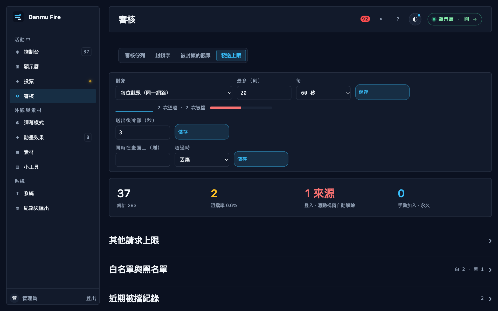
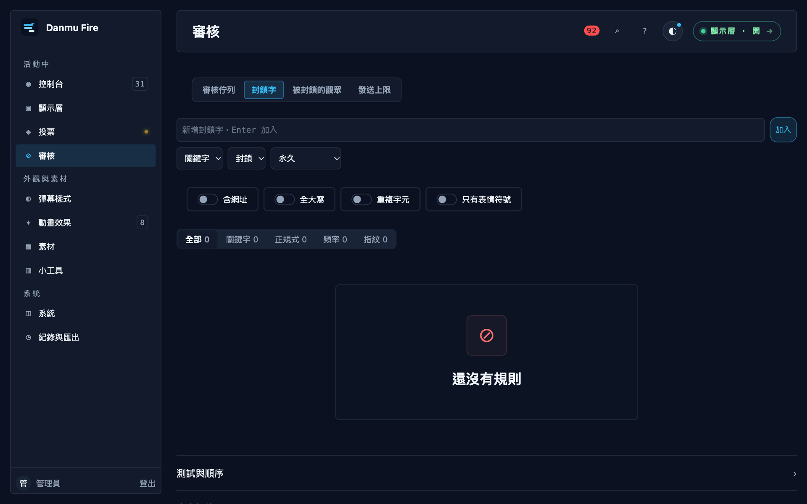

# 常見問題

### 觀眾送不出去，畫面寫「大螢幕還沒開啟」

顯示層沒連上。打開桌面客戶端，或在 OBS 加入 `/overlay`。

### 觀眾說送太慢，或刷太快

審核 → 發送上限。

### 彈幕太多，蓋住畫面

同一頁的「同時在畫面上」。

### 桌面客戶端連不上

它只走 `wss://`，伺服器要有 HTTPS。見 [DEPLOYMENT.md](https://github.com/guan4tou2/danmu-desktop/blob/main/DEPLOYMENT.md)。

### 有人洗版

控制台的訊息列上直接封鎖；或到審核 → 封鎖字加規則。

