# 主持人指南

側欄十列，由上到下。

## 活動中

### 控制台

看訊息、暫停或清空畫面、就地封鎖某個人。

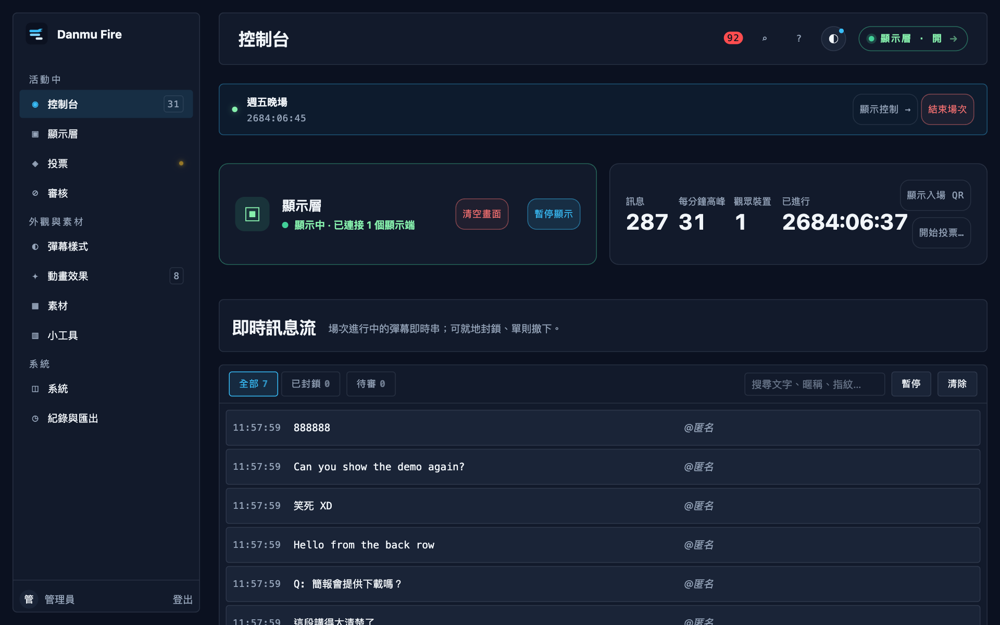

### 顯示層

開始、暫停、清空。

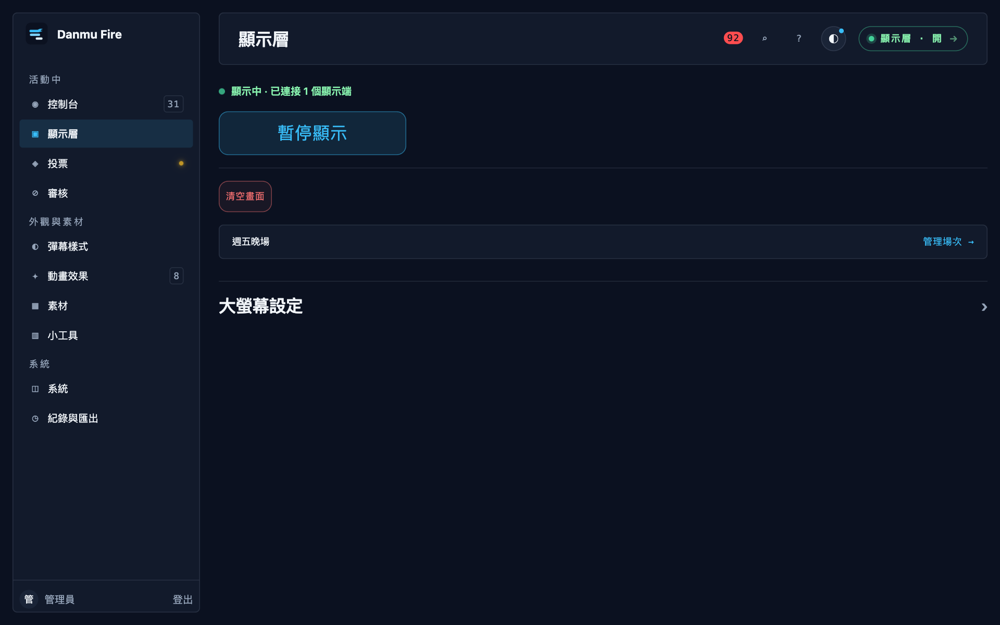

### 投票

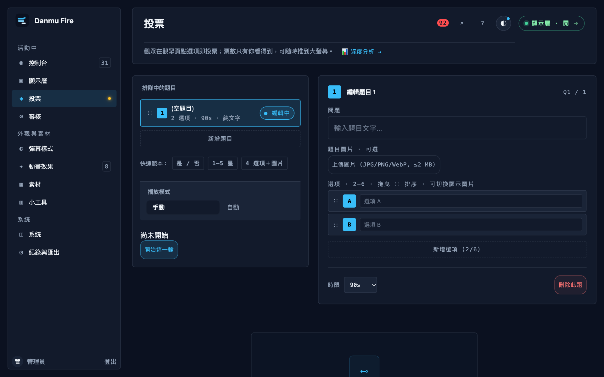

### 審核

封鎖字、被封鎖的觀眾、發送上限。

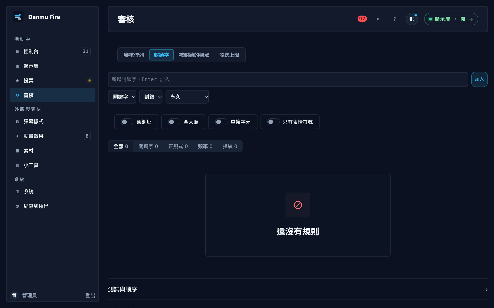

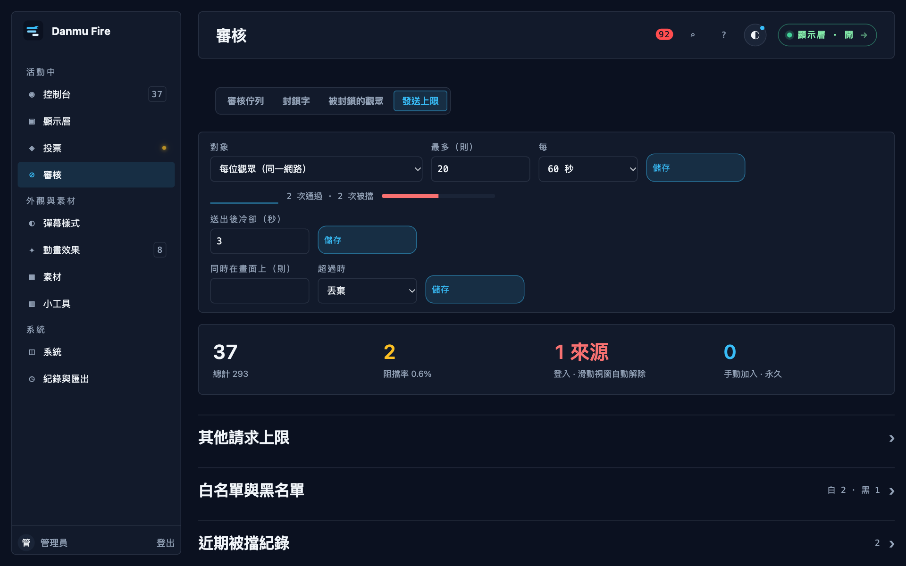

## 外觀與素材

### 彈幕樣式

主題，以及觀眾可以改什麼。

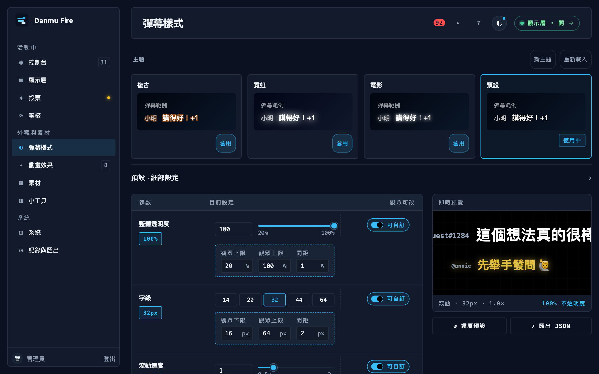

### 動畫效果

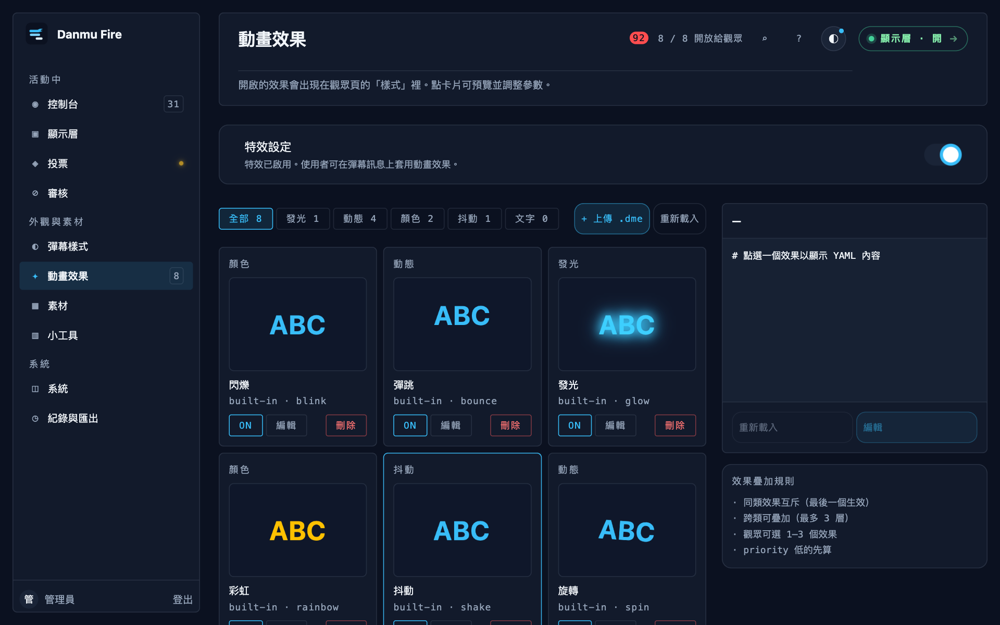

### 素材

表情、貼圖、字型、音效。

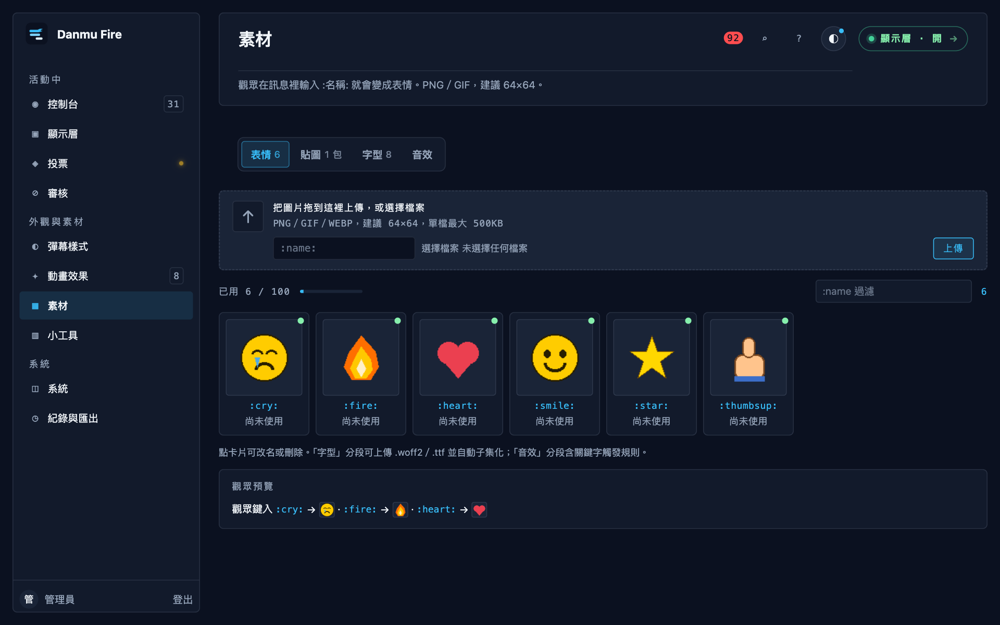

### 小工具

計分板、跑馬燈、標籤。

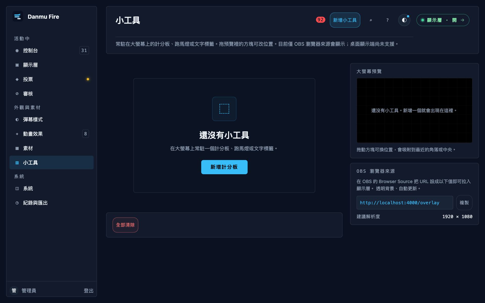

## 系統

### 系統

安全、備份與還原、擴充（Slido、Webhook、插件）。

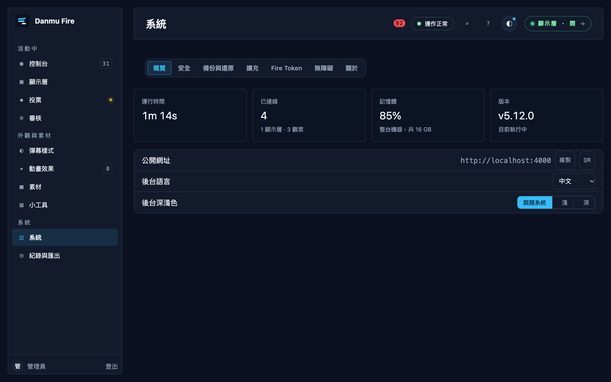

### 紀錄與匯出

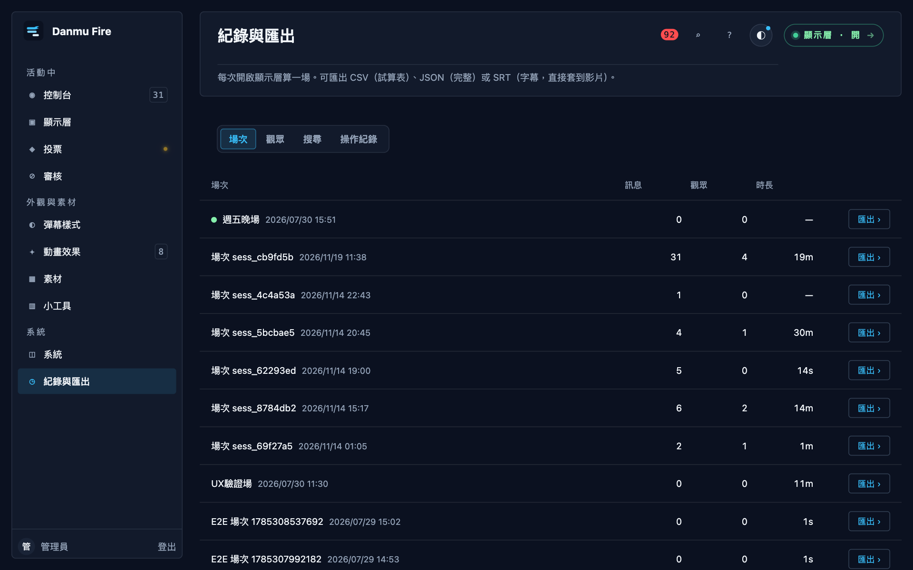
