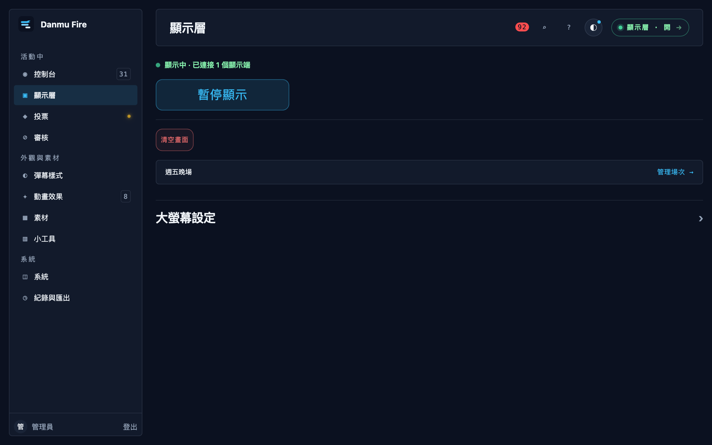
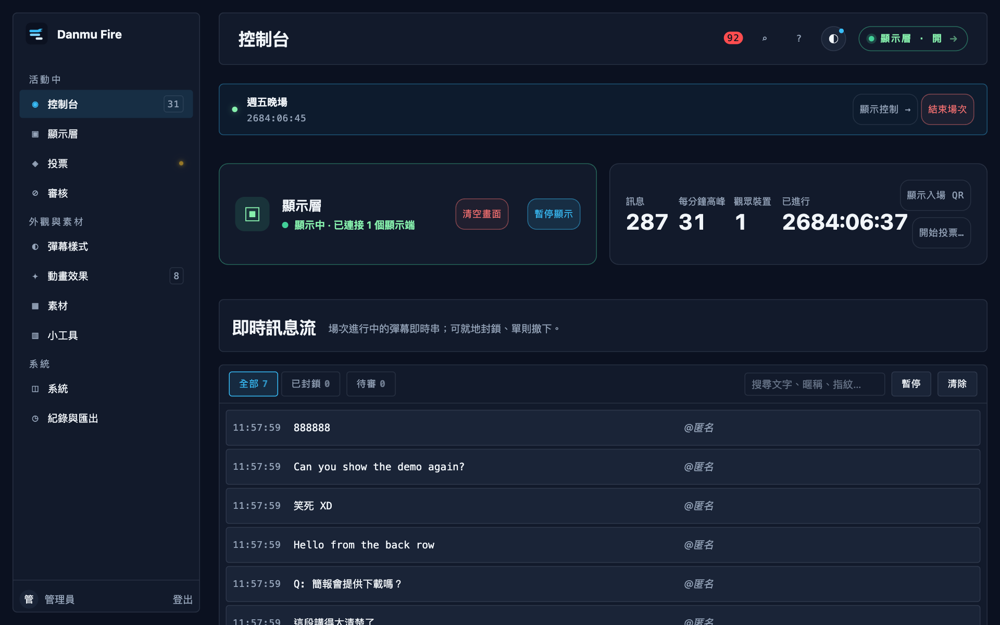
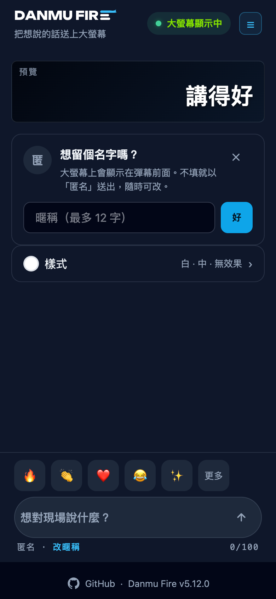

# 快速開始

## 1. 啟動伺服器

```bash
git clone https://github.com/guan4tou2/danmu-desktop.git
cd danmu-desktop
./setup.sh init
docker compose --profile https up -d
```

精靈會印出網址。後台在 `https://<host>/admin`。

## 2. 打開顯示層

二選一：

- **桌面客戶端**：[下載](https://github.com/guan4tou2/danmu-desktop/releases)，輸入主機與連接埠。
- **OBS**：瀏覽器來源填 `https://<host>/overlay`。

連上後，後台右上角變成綠色的「顯示層 · 開」。



## 3. 把網址給觀眾

控制台 → **顯示入場 QR**。



觀眾看到的是這樣：


